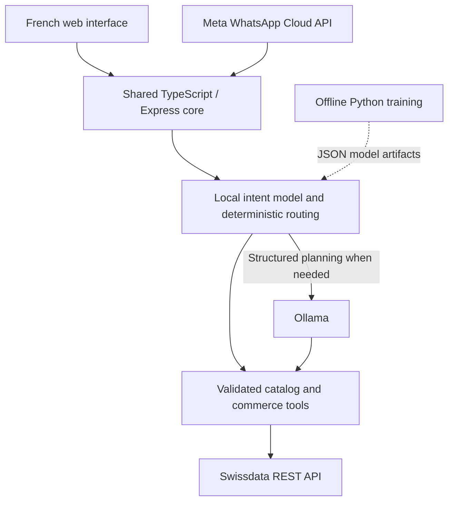

<h1 align="center">Zélo Assistant</h1>

<p align="center">
  <strong>From a French message to a real grocery basket.</strong><br>
  A hybrid conversational shopping assistant for the web and WhatsApp.<br>
  EPFL industrial Master's project · Zélo SA · 2026
</p>

<p align="center">
  <a href="src/"></a>
  <a href="Dockerfile"></a>
  <a href="ml/"></a>
  <a href="src/ai/services/ollama-client.ts"></a>
  <a href="src/integrations/meta/"></a>
  <a href="Dockerfile"></a>
</p>

<p align="center">
  <a href="https://assistant.zelo-epicerie.ch/">Live web demo</a> ·
  <a href="https://wa.me/41774013115">Chat on WhatsApp</a> ·
  <a href="#demos-and-presentation">Videos &amp; slides</a> ·
  <a href="#architecture">Architecture</a> ·
  <a href="#evaluation">Evaluation</a> ·
  <a href="#getting-started">Getting started</a>
</p>

---

## The project

Zélo Assistant connects natural-language requests to the real catalog, baskets and orders of a Swiss grocery business. Customers can add products, ask for meal ideas, manage their basket and update existing recurring orders through a French web interface or the **official Meta WhatsApp Cloud API**.

The engineering challenge is to turn an informal message into a valid business operation: identify the customer, understand quantities and options, resolve actual products, respect eligibility and regional constraints, and explain the result. The implementation combines **local machine learning, deterministic parsing, catalog-grounded ranking and constrained Ollama planners**, with a shared TypeScript/Express business core.

Developed as an industrial Master's project at **EPFL**, in collaboration with **Zélo SA**, the project covers system design, implementation, deployment, security engineering and experimental evaluation.

## Demos and presentation

| Resource | What to expect | Open |
| --- | --- | --- |
| **Web demo** · 4 min 54 sec | A walkthrough of the browser-based assistant and shopping workflow. | [Watch the web demo](https://github.com/tepoorte/zelo_ai/releases/download/showcase-2026/zelo-assistant-web-demo.mp4) |
| **WhatsApp introduction** · 1 min | A short introduction to the mobile conversation experience. | [Watch the WhatsApp introduction](https://github.com/tepoorte/zelo_ai/releases/download/showcase-2026/zelo-assistant-whatsapp-intro.mp4) |
| **EPFL project presentation** | The project motivation, architecture, implementation and evaluation. | [Download the slides (PowerPoint)](https://github.com/tepoorte/zelo_ai/releases/download/showcase-2026/zelo-assistant-presentation.pptx) |

Videos and slides are available as [project showcase assets](https://github.com/tepoorte/zelo_ai/releases/tag/showcase-2026).

## What it does

| Capability | Example request | Behavior |
| --- | --- | --- |
| Natural-language shopping lists | `Ajoute 2 pommes et 500 g de carottes` | Extract quantities and units, resolve catalog products and update the basket. |
| Basket management | `Montre mon panier` / `Garde seulement 2 pommes` | Read the current basket, remove selected items or adjust quantities. |
| Discover Meals | `Des idées pour le dîner autour de 30 CHF, sans poisson` | Compose eligible catalog suggestions from needs, exclusions and a budget target. |
| Existing recurring orders | `Ajoute du lait à ma commande récurrente du mardi` | Resolve the recurrence, prepare a before/after change and request confirmation. |
| Purchase-history suggestions | Suggestions after login or shopping actions | Prioritize frequently purchased products, with eligible fallback suggestions. |
| Order submission | `Passe la commande` | Submit through Swissdata using the authenticated customer's basket and delivery context. |

Single-product option choices use explicit clarification flows. Discover proposals are suggestions; adding them to the basket remains a separate action. Budget amounts guide composition and estimated totals rather than acting as absolute spending caps.

**Try it:** [web interface](https://assistant.zelo-epicerie.ch/) · [WhatsApp +41 77 401 31 15](https://wa.me/41774013115). Shopping operations require a Zélo customer account; the WhatsApp flow also supports account onboarding.

## Architecture



**Swissdata remains the authoritative commerce system.** The assistant integrates through REST adapters for products, customers, baskets, orders, delivery and recurring orders. Existing MongoDB/Redis storage sits behind that boundary; this service does not write directly to those databases.

### Why hybrid?

1. **Classify locally.** A compact TF-IDF linear model predicts seven active intents using lexical and n-gram features, confidence thresholds and margins.
2. **Parse business details in code.** French quantities, units, catalog matching, eligibility and basket calculations use explicit domain logic.
3. **Constrain language-model output.** Ollama produces structured plans with bounded contexts and output schemas. Specialized extraction validates proposed text spans against the original request.
4. **Ground recommendations.** Discover combines catalog profiles, learned needs/ranking models, deterministic feature hashing, semantic rules and product-graph composition.
5. **Execute through adapters.** Explicit action handlers perform commerce operations and manage clarification or confirmation states.

Python training produces JSON artifacts consumed by the JavaScript runtime. Customer intent corrections feed a separate feedback and retraining workflow. Purchase-history suggestions are separate from Discover ranking.

### Official Meta WhatsApp integration

The production WhatsApp path uses **Meta Cloud API**, with:

- **Signed webhooks:** HMAC-SHA256 verification over the original request body and message deduplication.
- **Verified customer access:** a six-digit email OTP, expiry, retry limits and resend cooldowns establish a customer-bound WhatsApp session.
- **Account onboarding:** short-lived, phone-bound HTTPS links support account creation, email validation and consent checks.
- **Protected pending data:** AES-256-GCM protects the pending onboarding payload; restricted file permissions and atomic writes support recovery.
- **Explicit choices:** product options, recurring-order changes and optional welcome baskets use dedicated interaction states.

Twilio and WhatsApp Web integrations remain in the repository as legacy/development paths. Production configuration enforces Meta Cloud API and OTP authentication.

## Evaluation

The Master's report separates component accuracy, functional checks, local performance and formative user feedback. Selected results from its **July 2026 evaluation snapshot** are:

| Experiment | Reported result | Scope |
| --- | --- | --- |
| Intent classifier validation | **99.21%** — 1,127 / 1,136 examples | Seven active intents; validation of the dated training artifact. |
| Separate UI intent test | **97.8%** — 91 prompts | Five intent classes represented in this smaller test. |
| Local web benchmark | **240 / 240 cycles completed** | Six fixed scenarios, 40 repetitions each, including basket refresh and business-state checks. |
| Budget interpretation audit | **15 / 15 cases passed** | Correct interpretation of budget requests and estimated totals; budget remains a composition target. |

In the local benchmark, adding one product without options averaged **160 ms** and Discover averaged **1.294 s**. Measurements used an Apple M4 MacBook Pro, Node.js 20 and Ollama with `llama3.2:1b`; they describe that local workload, including repeated formulations, rather than a production latency guarantee.

The report also documents a 905-product catalog snapshot, formative feedback from four usable questionnaire submissions, and two qualitative WhatsApp interviews. The repository includes subsequent onboarding work beyond that evaluation snapshot.

*Source: Samuel Tepoorten, “Zélo Assistant : conception et évaluation d’une couche conversationnelle hybride et sécurisée”, EPFL industrial Master's report, 2026, Chapter 10, pp. 80–89.*

## Repository guide

| Path | Purpose |
| --- | --- |
| [`src/ai/`](src/ai/) | Orchestration, structured planners, domain services and recommendation engines. |
| [`src/swissdata/`](src/swissdata/) | Commerce REST adapters, customer scope, delivery and basket contracts. |
| [`src/integrations/meta/`](src/integrations/meta/) | Meta webhooks, OTP, customer onboarding and welcome flows. |
| [`src/domain/`](src/domain/) | French numbers, units, normalization and text matching. |
| [`public/`](public/) | Web interface, local intent predictor and onboarding form. |
| [`ml/`](ml/) | Offline training, datasets and model artifact generation. |
| [`tests/`](tests/) | Domain regressions, isolation/security checks, onboarding tests and evaluation tools. |
| [`deploy/`](deploy/) | Deployment scripts, cache policy and infrastructure-specific notes. |

The older Build Meal recipe subsystem is retained for research and development; the customer chat currently routes meal requests to Discover.

## Getting started

### Prerequisites

- Node.js 20, matching the Docker build, and npm.
- A running Ollama service and the configured chat/planner model.
- Access to a Swissdata shop environment and your own API/account configuration.
- Meta business configuration and SMTP access when enabling WhatsApp and email verification.
- Python is required for retraining models, outside the online request path.

```bash
git clone https://github.com/tepoorte/zelo_ai.git
cd zelo_ai
npm ci --legacy-peer-deps --ignore-scripts
cp .env.sample .env
```

Configure `.env` for your environment. The published sample contains placeholders. In particular, set the Swissdata base URL, API key and shop ID, plus the Ollama connection:

```dotenv
NODE_ENV=development
PORT=3041
AI_PROVIDER=ollama
OLLAMA_BASE_URL=http://127.0.0.1:11434
OLLAMA_MODEL=llama3.2:1b
OLLAMA_PLANNER_MODEL=llama3.2:1b
```

The sample's `host.docker.internal` addresses target Docker-to-host connections; use the appropriate address for your local topology. The implemented assistant entry point delegates to Ollama.

```bash
ollama pull llama3.2:1b
npm run build
npm start
```

Open [localhost:3041](http://localhost:3041) and check [`/health`](http://localhost:3041/health). Use `npm run dev` for development. Docker images are defined in [`Dockerfile`](Dockerfile) and [`Dockerfile.dev`](Dockerfile.dev).

### Training and tests

The repository includes trained artifacts and offline workflows for rebuilding them against the appropriate catalog:

```bash
npm run setup:intents
npm run train:intents
npm run setup:discover-meals
npm run train:discover-meals
```

Focused regression commands include:

```bash
npm run test:intents
npm run test:clear-cart
npm run test:session-isolation
npm run test:whatsapp-onboarding-store
npm run test:security
```

See [`package.json`](package.json) for the complete script list. The [live smoke suite](tests/smoke/README.md) and random catalog integration tests operate on a real account's basket; use a dedicated test account for those workflows.

## Engineering scope

- Web cookies, email OTP, Meta signatures, product eligibility checks, log redaction and protected onboarding are implemented controls backed by regression tests.
- Most sessions, pending actions and deduplication state remain process-local. Onboarding has dedicated persistence; shared state for multiple instances is a further engineering step.
- Catalog snapshots and model artifacts are versioned research assets. Prices, availability, delivery fees and account behavior depend on the connected Swissdata environment.
- Production deployment uses environment-specific infrastructure and credentials. The scripts in `deploy/` should be adapted to the target environment, with runtime data preserved according to the [cache policy](deploy/CACHE.md).

## Contributors and academic context

- **[Samuel Tepoorten](https://github.com/tepoorte)** — project author and implementation.
- **Thomas Hächler** — contributor.
- **Jean-Cédric Chappelier** — academic supervisor, EPFL.
- **André Burri** — company supervisor, Zélo SA.

Built as an industrial Master's project with **Zélo SA** and **EPFL**. The accompanying report covers the design decisions, experiments, limitations and future work of the conversational layer.
